<p align="center">
  
</p>

<h1 align="center">Vocium</h1>

<p align="center"><b>Press a key, speak, and the words land where you were typing.</b></p>

<p align="center">
  <a href="README.md">繁體中文</a> · <b>English</b>
</p>

<p align="center">
  
  
  
  
</p>

<p align="center">
  
</p>

---

## What it is

Vocium is AI voice typing for the desktop.

- Put the cursor in **any** app's text field.
- Press the hotkey. Speak.
- The text is pasted in. No focus stolen, no extra window.

Recognition runs on a cloud service with **your own** key (Groq, OpenAI, Gemini). No server, no account, keys never leave your machine.

---

## Features

| | |
|---|---|
| 🎙️ **Two ways to talk** | Toggle: press to start, press to stop. Push-to-talk: hold to record, release to send. Hotkey is yours to choose. |
| 🔑 **Bring your own key** | Groq, OpenAI Whisper or Gemini. The OpenAI-compatible base URL works with self-hosted services. |
| ✨ **AI polish (optional)** | Let an LLM add punctuation, drop fillers and smooth the sentence before pasting. Three styles, custom prompt. |
| 🀄 **Chinese script control** | Force Traditional (Taiwan) or Simplified output, whatever the model returned. Offline. |
| 📋 **Clipboard-friendly** | Your previous clipboard text is put back after the paste. |
| 🩺 **Tray health panel** | Microphone, permissions, key and hotkey status at a glance; a failing row opens the right settings page. |
| 🧩 **Single process** | One executable, no background service. The core is a pure-TypeScript package you can reuse elsewhere. |

---

## Three steps

### 1. Install

No published installers yet — build from source. You need **Node.js ≥ 20** and the **Rust toolchain**.

<details>
<summary>🪟 Windows toolchain (PowerShell)</summary>

```powershell
winget install --id OpenJS.NodeJS.LTS
winget install --id Rustlang.Rustup
winget install --id Microsoft.VisualStudio.2022.BuildTools   # select "Desktop development with C++"
```

WebView2 Runtime ships with Windows 10 2020+ / 11. Open a new shell afterwards so `PATH` is updated.
</details>

<details>
<summary>🍎 macOS toolchain (Terminal)</summary>

```bash
xcode-select --install
brew install node
curl --proto '=https' --tlsv1.2 -sSf https://sh.rustup.rs | sh
```
</details>

```bash
git clone https://github.com/Hereisaa/vocium.git
cd vocium
npm install
npm run dev
```

To build installers: `npm run package` → `app-tauri/src-tauri/target/release/bundle/`.

### 2. Add a key

System tray → **Vocium → Settings… → Speech-to-text**. Pick a provider, paste the key, save.

| Provider | Get a key | Notes |
|---|---|---|
| **Groq** (recommended) | [console.groq.com](https://console.groq.com) | Free tier; fast and accurate for Chinese |
| **OpenAI** | [platform.openai.com/api-keys](https://platform.openai.com/api-keys) | Custom base URL for compatible services |
| **Gemini** | [aistudio.google.com/apikey](https://aistudio.google.com/apikey) | — |

### 3. Speak

1. Click into any text field.
2. Press **Ctrl+Shift+Space** (default).
3. Speak, then press again.
4. The text appears.

---

## Permissions

| Platform | Needs | How |
|---|---|---|
| Windows | Microphone | The OS asks on first recording; click Allow. |
| macOS | Microphone | The OS asks on first recording. |
| macOS | Accessibility | **System Settings → Privacy & Security → Accessibility**, add Vocium and enable it. Without it the text is still copied to the clipboard — press Cmd+V yourself. |

> **Paste stopped working after repackaging on macOS?** Every `npm run package` is a new signature, which macOS treats as a different app. Remove the old Vocium row from the Accessibility list and add the new one.

---

## Settings

Everything lives in the tray's **Settings…** window, three tabs:

- **General**: UI language, hotkey, microphone, input mode, silence trimming, Chinese script.
- **Speech-to-text**: provider, key, model.
- **AI polish**: on/off, provider, model, style.

File location and every field: [docs/CONFIGURATION.md](docs/CONFIGURATION.md).

---

## How it works

```
hotkey → record → cloud STT → AI polish (optional) → zh conversion → paste into the focused window
```

- The **Rust shell** does only OS work: window, tray, hotkey, config file, paste.
- **voice-core** is a pure-TypeScript package: state machine, recognition, polish, script conversion. It runs inside the app's webview.
- Only real transcripts are pasted. Silence, a failed request or a missing key only show a notice on the floating icon — your document stays clean.

Architecture, IPC contract and decision log: [docs/ARCHITECTURE.md](docs/ARCHITECTURE.md) (the single source of truth, zh-TW). Interactive diagrams: [docs/archify/](docs/archify/).

---

## Reuse the core in your own project

```ts
import { createSttAdapter, normalizeConfig } from '@vocium/voice-core';

const cfg = normalizeConfig({ sttProvider: 'groq', groqApiKey: process.env.GROQ_KEY });
const stt = createSttAdapter(cfg, { fetch });
const { text } = await stt.transcribe({ audio: bytes, mimeType: 'audio/webm' });
```

The package depends only on `fetch` — browser, Node and Bun all work. It lives in `packages/voice-core/`.

---

## Documentation

| Doc | What |
|---|---|
| [ARCHITECTURE.md](docs/ARCHITECTURE.md) | Architecture SSOT: boundaries, state machine, IPC, decisions (zh-TW) |
| [CONFIGURATION.md](docs/CONFIGURATION.md) | Config fields, provider keys, polish |
| [ROADMAP.md](docs/ROADMAP.md) | Shipped, planned, deferred |
| [CONTRIBUTING.md](docs/CONTRIBUTING.md) | Dev workflow, test gates, adding providers |
| [archify/](docs/archify/) | Interactive architecture + workflow diagrams |
| [ICON_DESIGN](https://hereisaa.github.io/vocium/ICON_DESIGN.html) · [DESIGN_MOCKUP](https://hereisaa.github.io/vocium/DESIGN_MOCKUP.html) | Icon and UI design |

---

## License

MIT
