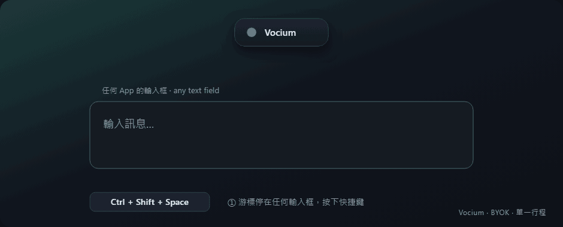

<p align="center">
  
</p>

<h1 align="center">Vocium</h1>

<p align="center">
  <b>桌面 AI 智慧語音輸入。</b>
</p>

<p align="center">
  <b>繁體中文</b> · <a href="README.en.md">English</a>
</p>

<p align="center">
  
  
</p>

<p align="center">
  
</p>

---

按下快捷鍵、開口說話，AI 即時將語音轉為文字並自動貼入目前焦點的輸入框——不搶焦點、無伺服器、不內建任何憑證。支援 Windows 與 macOS。

## 架構

單一行程。Tauri 2（Rust）殼層只做作業系統層的事：視窗、系統匣、全域快捷鍵、設定檔、原生文字注入。所有語音邏輯——狀態機、錄音、STT、AI 潤稿、繁簡轉換——是 **`@vocium/voice-core`**，一個純 TypeScript 套件，直接在懸浮 ICON 的 webview 裡執行。網路請求經由 Tauri 的 http 插件由 Rust 發出。

```
Vocium.exe（唯一行程）
  ├ Rust 殼層     視窗 · Tray · 快捷鍵 · 設定檔 · 剪貼簿＋貼上鍵
  └ webview       UI + voice-core（狀態機 · STT · 潤稿 · 繁簡）
```

`packages/voice-core/` 不依賴任何平台 API（只需要一個 `fetch`），可以在瀏覽器、Node 或 Bun 裡重用。

## 功能

- **懸浮 ICON** — 鎖定／解除拖曳、縮小到系統匣、不搶焦點
- **切換模式或按鍵發話** — 可自訂全域快捷鍵
- **多家雲端 STT** — Groq、OpenAI Whisper、Gemini；自備金鑰（BYOK），僅存本機
- **AI 潤稿** — 注入前可選的 LLM 潤飾（標點、贅詞、通順）
- **中文輸出** — 強制繁體或簡體；可選 VAD 靜音修剪
- **剪貼簿還原** — 注入後把你原本的剪貼簿文字放回去

---

### 前置需求

| 工具 | 用途 | 備註 |
|---|---|---|
| **Node.js ≥ 20** | 編譯 voice-core 與 webview | 內含 `npm` |
| **Rust 工具鏈** | 建置 Tauri 殼 | — |

平台額外需求：
**Windows** — WebView2 Runtime（Win 10 2020+/11 已內建）+ MSVC Build Tools（勾選 *「使用 C++ 的桌面開發」* 工作負載）。
**macOS** — Xcode Command Line Tools（`xcode-select --install`）。

---

## 快速安裝指令

無發佈的安裝檔 —— 從原始碼建置

### 前置環境

**🪟 Windows（PowerShell）：**
```powershell
winget install --id OpenJS.NodeJS.LTS          # Node.js（LTS, ≥ 20）
winget install --id Rustlang.Rustup            # Rust
winget install --id Microsoft.VisualStudio.2022.BuildTools  # 勾「使用 C++ 的桌面開發」
```

**🍎 macOS（Terminal）：**
```bash
xcode-select --install                                          # Xcode CLT（系統對話框）
brew install node                                               # Node.js（≥ 20），或用 nvm
curl --proto '=https' --tlsv1.2 -sSf https://sh.rustup.rs | sh  # Rust
```

安裝 Rust 後請開新 shell，讓更新後的 `PATH` 生效。

### 確認版本

```bash
node -v   # ≥ 20（建議 LTS）
npm -v    # 應乾淨印出版本，不該報相容性錯誤
cargo -V
```

### 從原始碼執行

```bash
git clone https://github.com/Hereisaa/vocium.git
cd vocium
npm install
npm run dev   # 編譯 voice-core 與 webview，再透過 `tauri dev` 啟動桌面程式
```

### 打包成應用程式

```bash
npm run package # 產生獨立安裝檔
# 產物在 `app-tauri/src-tauri/target/release/bundle/`
```

**🪟 Windows**

| 格式 | 路徑 | 說明 |
|---|---|---|
| `.msi` | `bundle/msi/Vocium_<ver>_x64_en-US.msi` | 群組原則／靜默安裝 |
| `.nsis` | `bundle/nsis/Vocium_<ver>_x64-setup.exe` | 體積小，OSS 常用 |

首次啟動（未簽署）：SmartScreen →**其他資訊 → 仍要執行**。

**🍎 macOS**

| 格式 | 路徑 | 說明 |
|---|---|---|
| `.app` | `bundle/macos/Vocium.app` | 可執行的應用程式 bundle |
| `.dmg` | `bundle/dmg/Vocium_<ver>_{x64\|aarch64}.dmg` | 散佈用磁碟映像 |

首次啟動（未簽署）：Gatekeeper →**右鍵 → 打開 → 仍要打開**（一次）。
※ 未簽署版每次 rebuild 需重新授權輔助使用——見 [權限](#權限)。

---

## 權限

Vocium 首次執行需要作業系統層級權限，內容與還原流程兩平台略有不同。

**🪟 Windows**

| 權限 | 用途 | 怎麼給 |
|---|---|---|
| **麥克風** | 錄你的語音 | 首次錄音時 Windows 跳標準權限對話框——點*允許* |

不需要貼上權限——Vocium 直接用 Win32 剪貼簿 API 與 `SendInput` 送出 Ctrl+V，不需提權。

**🍎 macOS**

| 權限 | 用途 | 怎麼給 |
|---|---|---|
| **麥克風** | 錄你的語音 | 首次錄音時 macOS 跳系統提示；授予給 App（或執行 `npm run dev` 的終端機） |
| **輔助使用** | 把貼上按鍵（Cmd+V）送到焦點 App | **系統設定 ▸ 隱私權與安全性 ▸ 輔助使用** — 加入 Vocium 並打勾啟用 |

未授予輔助使用時，轉錄文字仍會複製到剪貼簿，懸浮 ICON 顯示指引文字 —— 你可手動 Cmd+V 貼上。

> **遇到 npm run package 之後無法觸發自動貼上，解決方式** :
每次 `npm run package` 都產生新的 ad-hoc 簽章，macOS 把每次 rebuild 當成不同 App —— 舊的輔助使用綠勾還在，但指向已失效的 binary。若 rebuild 後「轉錄成功但貼上不發生」：
**系統設定 ▸ 隱私權與安全性 ▸ 輔助使用 → 移除舊的 Vocium 列 → 加入新的 `Vocium.app` 並啟用**。
dev loop（`npm run dev`）重用已授權的 entry，故此問題只出現在 packaged 版。

---

## Tray 健康面板

系統列選單即時顯示麥克風裝置、麥克風權限、STT 金鑰、全域快捷鍵、（macOS）輔助使用的狀態。失敗項以 ⚠ 標示且可點——直接開啟對應的系統設定頁或內部設定視窗。若有阻斷性檢查失敗（無麥克風或權限被拒），按快捷鍵不會進入聆聽，UI 顯示原因。

---

## 操作

1. 把焦點放在任一輸入框。（當下無焦點則複製到剪貼簿）
2. 按快捷鍵 或 點擊 Vocium → Vocium 進入 **聆聽中**。
3. **說話。**
4. 再按一次 → 轉錄成功

**切換模式** — 按一次開始，再按一次停止並轉錄。
**按鍵發話** — 按住錄音，鬆手即轉錄。

首次執行需設定 STT API 金鑰——見 [CONFIGURATION.zh-TW.md](docs/CONFIGURATION.zh-TW.md)。

---

## 在其他專案重用 voice-core

```ts
import { createSttAdapter, normalizeConfig, polishText } from '@vocium/voice-core';

const cfg = normalizeConfig({ sttProvider: 'groq', groqApiKey: process.env.GROQ_KEY });
const stt = createSttAdapter(cfg, { fetch });
const { text } = await stt.transcribe({ audio: bytes, mimeType: 'audio/webm' });
```

套件只依賴 `fetch`，沒有 Node 或 DOM 依賴；目前以 npm workspace 形式存在於 `packages/voice-core/`。

---

## 文件

| 文件 | 內容 |
|---|---|
| [docs/ARCHITECTURE.md](docs/ARCHITECTURE.md) | **架構 SSOT**：行程邊界、原始碼地圖、狀態機、IPC 契約、決策紀錄 |
| [docs/archify/vocium-architecture.html](docs/archify/vocium-architecture.html)、[voice-input-workflow.html](docs/archify/voice-input-workflow.html) | 互動式架構圖與流程圖（Archify，從同目錄的 JSON 渲染，含原始碼溯源） |
| [docs/CONFIGURATION.zh-TW.md](docs/CONFIGURATION.zh-TW.md) | `vocium-config.json`、各家 BYOK 金鑰設定、AI 潤稿 |
| [docs/ROADMAP.zh-TW.md](docs/ROADMAP.zh-TW.md) | 已完成／規劃中／延後的項目 |
| [docs/CONTRIBUTING.zh-TW.md](docs/CONTRIBUTING.zh-TW.md) | 開發流程、build gates、新增 provider |
| [DESIGN_MOCKUP](https://hereisaa.github.io/vocium/DESIGN_MOCKUP.html)、[ICON_DESIGN](https://hereisaa.github.io/vocium/ICON_DESIGN.html) | 設計圖（線上預覽） |

---

## 授權

MIT
